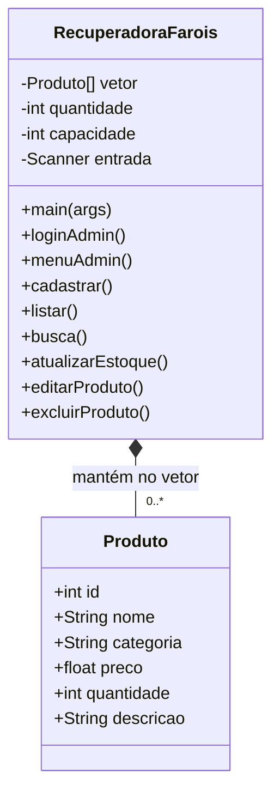
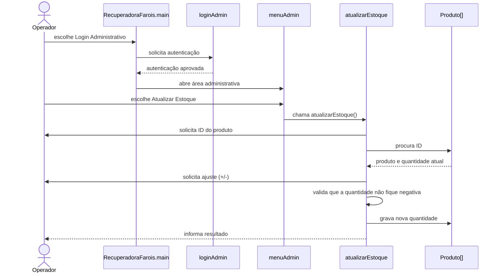

# Soares Recuperadora de Faróis — entregas acadêmicas

Documento complementar para reunir os artefatos das Sprints 3 a 9 em um só lugar. Foi
preparado a partir do relatório da Soares, dos guias da disciplina e do código Java original.
Exemplos genéricos dos guias não são requisitos deste sistema.

## Situação do projeto

- O programa Java permanece no arquivo `RecuperadoraFarois.java`, sem reestruturação.
- O código mantém os produtos em um vetor durante a execução. Não há conexão Java com PostgreSQL.
- O relatório contém uma proposta de modelo relacional, DDL e DAO/Repository; isso não significa
  que esses elementos já estejam implementados no programa.
- A entrevista de código de 09/11 não teve resultado informado.
- O cronograma coloca as Sprints 8 e 9 no mesmo período (16/11–30/11); confirmar essa data com a
  equipe/professor.

## Sprint 3 — histórias de usuário e casos de uso

As histórias abaixo seguem o escopo da Soares descrito no relatório.

### US-01 — Cadastro de produtos

Como operador da empresa, quero cadastrar produtos com seus dados principais para manter as
informações organizadas.

**Aceite:** solicitar os campos; impedir dados obrigatórios ausentes; recusar preço e quantidade
negativos; disponibilizar o produto para consulta.

### US-02 — Busca de produtos

Como atendente, quero pesquisar produtos por critérios de identificação para localizar rapidamente
suas informações.

**Aceite:** permitir informar um critério; mostrar os dados correspondentes; informar quando não
houver resultado.

### US-03 — Atualização do estoque

Como operador, quero ajustar a quantidade de um produto para manter o estoque registrado atualizado.

**Aceite:** selecionar produto cadastrado; validar a nova quantidade; não alterar o valor anterior
se o ajuste for inválido.

### Casos de uso correspondentes ao código atual

| ID | Caso de uso | Fluxo principal |
|---|---|---|
| UC-01 | Consultar produto | No menu principal, escolher busca e informar o ID. |
| UC-02 | Listar produtos | No menu principal ou administrativo, escolher listagem. |
| UC-03 | Cadastrar produto | Entrar na área administrativa e informar os campos do produto. |
| UC-04 | Atualizar estoque | Informar ID e ajuste positivo ou negativo; o sistema impede saldo negativo. |
| UC-05 | Editar produto | Informar ID, validar o novo ID e preencher os novos dados. |
| UC-06 | Excluir produto | Informar ID; o sistema remove o item e desloca os seguintes no vetor. |

## Sprints 4 e 5 — CLI, navegação e rastreabilidade

### Mapa de navegação descrito no relatório

```text
Início
├── Área do cliente
│   └── Consultar faróis disponíveis → Busca e filtros → Detalhes do produto → Contato
└── Área administrativa
    └── Cadastrar produto → Listar e buscar → Atualizar estoque
```

### Fluxo presente no código Java

```text
Menu principal
├── Buscar produto por ID
├── Listar produtos
├── Login administrativo
│   └── Cadastrar → Listar → Buscar → Atualizar estoque → Editar → Excluir → Logout
├── Contatos
├── Sobre a empresa
└── Sair
```

Os dois fluxos diferem: o mapa prevê busca e filtros para o cliente, enquanto o programa busca por
ID e oferece contatos/sobre como opções separadas. A equipe deve confirmar qual fluxo representa a
versão a ser apresentada.

### Matriz de rastreabilidade

| Requisito | História | Código atual | Lacuna / evidência a produzir |
|---|---|---|---|
| RF-01 Cadastrar produto | US-01 / UC-03 | `cadastrar()` coleta ID, nome, categoria, quantidade, preço e descrição. | Marca e modelo/ano aparecem no requisito, mas não no registro Java. Registrar demonstração do cadastro após confirmar escopo. |
| RF-02 Listar produtos | US-01 / UC-02 | `listar()` percorre o vetor e mostra os produtos. | Registrar lista vazia e lista preenchida. |
| RF-03 Buscar e filtrar | US-02 / UC-01 | `busca()` localiza pelo ID. | O requisito prevê nome, categoria, marca e modelo/ano; o código não oferece esses filtros. |
| RF-04 Atualizar estoque | US-03 / UC-04 | `atualizarEstoque()` aplica ajuste e recusa quantidade negativa. | Registrar ajuste positivo, negativo válido e negativo inválido. |
| RF-05 Validar dados | US-01 / US-03 | Valida ID positivo/único, preço não negativo e quantidade não negativa. | Campos de texto podem ficar vazios; documentar se isso será aceito nesta versão. |
| Edição e exclusão | UC-05 / UC-06 | `editarProduto()` e `excluirProduto()` existem no código. | Confirmar no documento de requisitos se serão requisitos formais e atribuir IDs antes da entrega. |

## Sprint 6 — persistência proposta

O relatório propõe PostgreSQL e as entidades Categoria, Produto e Orçamento. O DDL abaixo é a
proposta documentada; não foi executado e não há DAO/Repository Java no código original.

```sql
CREATE TABLE categoria (
    id_categoria INTEGER GENERATED ALWAYS AS IDENTITY PRIMARY KEY,
    nome VARCHAR(100) NOT NULL UNIQUE,
    descricao TEXT
);

CREATE TABLE produto (
    id_produto INTEGER GENERATED ALWAYS AS IDENTITY PRIMARY KEY,
    nome VARCHAR(150) NOT NULL,
    descricao TEXT,
    preco NUMERIC(10, 2) CHECK (preco IS NULL OR preco >= 0),
    quantidade INTEGER NOT NULL DEFAULT 0 CHECK (quantidade >= 0),
    marca VARCHAR(100),
    modelo VARCHAR(100),
    id_categoria INTEGER NOT NULL,
    CONSTRAINT fk_produto_categoria FOREIGN KEY (id_categoria)
        REFERENCES categoria(id_categoria)
        ON UPDATE CASCADE ON DELETE RESTRICT
);

CREATE TABLE orcamento (
    id_orcamento INTEGER GENERATED ALWAYS AS IDENTITY PRIMARY KEY,
    nome_cliente VARCHAR(150) NOT NULL,
    email VARCHAR(150) NOT NULL,
    mensagem TEXT NOT NULL
);
```

### Responsabilidades previstas para DAO/Repository

| Entidade | Operações previstas na camada de persistência |
|---|---|
| Categoria | Cadastrar, listar e buscar categoria; verificar uso por produtos antes de exclusão. |
| Produto | Cadastrar, listar, buscar por ID e filtros, editar, atualizar estoque e excluir. |
| Orçamento | Cadastrar e consultar solicitações de orçamento. |

Essas operações são um contrato acadêmico proposto para quando a equipe implementar persistência.
O documento não define assinaturas Java nem afirma que exista conexão JDBC. O modelo usa categoria
relacionada por chave estrangeira e inclui orçamento; o objeto `Produto` do código atual guarda a
categoria como texto e não possui marca/modelo, portanto a equipe precisa validar o mapeamento antes
de implementar essa camada.

## Sprint 7 — diagramas do código atual

### Diagrama de classes simplificado



### Sequência — atualização do estoque



Esses diagramas representam o programa atual, não uma arquitetura em camadas que ainda não existe.

## Sprint 8 — roteiro e registro de testes

Os casos abaixo estão preparados para execução manual. A coluna de resultado real fica em branco até
que alguém execute o cenário no programa e registre a evidência; nenhum teste está marcado como
aprovado sem execução.

| ID | Rastreabilidade | Cenário / condição inicial | Resultado esperado | Resultado real / evidência |
|---|---|---|---|---|
| CT-01 | RF-01 / UC-03 | Cadastrar produto com dados válidos. | Produto incluído e disponível na listagem. | A preencher: resultado observado, data e captura ou anotação. |
| CT-02 | RF-01, RF-05 / UC-03 | Informar ID zero ou repetido durante cadastro. | Solicitar outro ID; não duplicar produto. | A preencher: resultado observado, data e captura ou anotação. |
| CT-03 | RF-01, RF-05 / UC-03 | Informar preço ou quantidade negativa no cadastro. | Solicitar novo valor; não concluir cadastro com valor inválido. | A preencher: resultado observado, data e captura ou anotação. |
| CT-04 | RF-02 / UC-02 | Listar com vetor vazio. | Exibir “Nenhum produto cadastrado”. | A preencher: resultado observado, data e captura ou anotação. |
| CT-05 | RF-03 / UC-01 | Buscar um ID existente e depois um inexistente. | Mostrar o produto ou “Produto não encontrado”. | A preencher: resultado observado, data e captura ou anotação. |
| CT-06 | RF-04 / UC-04 | Fazer ajuste positivo e ajuste negativo que mantenha saldo não negativo. | Atualizar e mostrar o novo saldo. | A preencher: resultado observado, data e captura ou anotação. |
| CT-07 | RF-04 / UC-04 | Tentar ajustar estoque para valor abaixo de zero. | Recusar o ajuste e manter a quantidade anterior. | A preencher: resultado observado, data e captura ou anotação. |
| CT-08 | Requisito formal a confirmar / UC-05, UC-06 | Editar um produto e excluir outro. | Refletir as alterações na listagem. | A preencher: resultado observado, data e captura ou anotação. |
| CT-09 | Entrada de menu | Digitar texto em uma opção numérica do menu principal e do administrativo. | Manter o programa aberto e exibir “Opcao invalida!”. | A preencher: resultado observado, data e captura ou anotação. |

Este roteiro pode ser executado manualmente sobre o Java atual. JUnit e teste de integração com banco
não estão presentes. Como o programa atual concentra entrada, estado e operações numa classe com
métodos estáticos, testes automatizados e integração exigem uma decisão de arquitetura da equipe.

## Sprint 9 — roteiro da apresentação final

1. Demandante e problema de controle de produtos/estoque.
2. Objetivo, requisitos e histórias de usuário.
3. Mapa de navegação e demonstração da CLI atual.
4. Diagrama de classes e sequência correspondentes ao código.
5. Modelo relacional e DDL como proposta documentada.
6. Resultados reais dos casos de teste executados pela equipe.
7. Lacunas assumidas e próximos passos.

Não apresentar DAO, PostgreSQL conectado, JUnit ou resultados de testes como concluídos sem que a
equipe os implemente e obtenha evidências.

